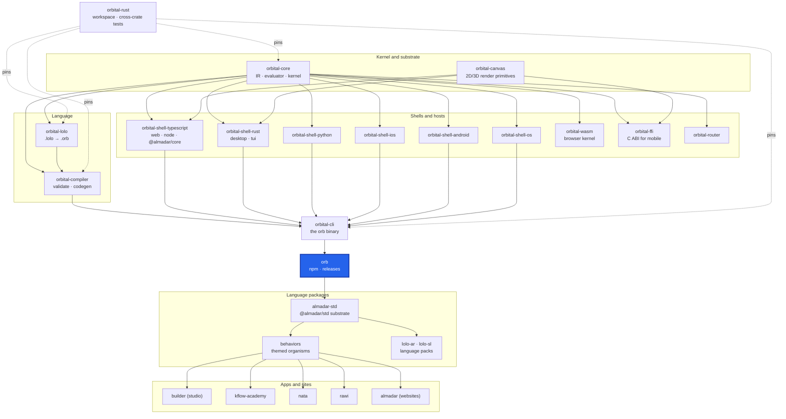

<div align="center">

# Orb

**The `orb` command-line tool for the Almadar language, distributed through npm, GitHub releases and installer scripts, plus the orb.almadar.io site.**

[](https://github.com/almadar-io/orb/actions/workflows/ci.yml)
[](https://github.com/almadar-io/orb/actions/workflows/deploy.yml)
[](https://www.npmjs.com/package/@almadar/orb)
[](./LICENSE)

</div>

`orb` is the one binary behind Almadar: it reads a `.lolo` program, lowers it to the `.orb` IR, validates the whole graph, runs and tests it, and emits it. This repository does not hold the Rust source. It holds how the binary reaches you (the `@almadar/orb` npm wrapper and per-platform packages, installers, GitHub releases), the reusable advisory-redeploy workflow for apps, and the source of [orb.almadar.io](https://orb.almadar.io), which is built from the `std-almadar-orb` organism.

## Where this fits



| Upstream (this repo depends on) | Downstream (depends on this repo) |
|---|---|
| [orbital-cli](https://github.com/almadar-io/orbital-cli): the Rust crates behind the `orb` binary (the binary release build is moving there) | [almadar-std](https://github.com/almadar-io/almadar-std): its packages install and update through `orb` |
| [orbital-rust](https://github.com/almadar-io/orbital-rust): workspace that pins the crates the binary is built from | [behaviors](https://github.com/almadar-io/behaviors), apps and sites: validated and run with `orb` |

## Quick start

```bash
npm install -g @almadar/orb                          # npm
npx @almadar/orb validate app.lolo                   # no install
curl -fsSL https://orb.almadar.io/install.sh | sh    # macOS / Linux, installs to ~/.orb/bin
irm https://orb.almadar.io/install.ps1 | iex         # Windows PowerShell
brew install almadar-io/tap/orb                      # Homebrew (see the note below)
```

```bash
orb validate orders.lolo        # 0 errors and 0 warnings, or it does not ship
orb emit orb orders.lolo        # the same program as .orb JSON
orb test orders.orb             # generated cases: every legal move, every illegal one
```

`orb --version` prints the binary version and the language it reads, for example `orb 18.0.5 (language ^1)`.

## Distribution

| Channel | What it is |
|---|---|
| npm | [`@almadar/orb`](https://www.npmjs.com/package/@almadar/orb) is a thin launcher (`cli/npm`). It depends on `bun` and lists five platform packages as optional dependencies; npm installs the one that matches your machine. Its postinstall runs `orb update --global`. |
| Platform packages | `@almadar/orb-darwin-arm64`, `@almadar/orb-darwin-x64`, `@almadar/orb-linux-arm64`, `@almadar/orb-linux-x64`, `@almadar/orb-windows-x64`. Each carries the binary and records the language range it reads (`orbReads`). |
| GitHub releases | `install.sh` and `install.ps1` download `orb-<platform>.tar.gz` (`.zip` on Windows) from this repo's releases (`install.sh`) and install into `ORB_INSTALL_DIR` (default `~/.orb/bin`); `ORB_VERSION` or `--version` pins a release. |
| Homebrew | `brew install almadar-io/tap/orb` (tap `almadar-io/homebrew-tap`). `cli/homebrew/orb.rb` in this repo is a formula template with placeholder checksums and releases URLs under `almadar-io/almadar`; the tap itself is not in this repo. |

Publishing runs in `.github/workflows/publish-npm.yml`: an `orb-release` `repository_dispatch` (or a manual run with a version) starts it, and the workflow stages the platform packages from `cli/dist/<platform>` and publishes the wrapper and the platform packages.

### Updating

```bash
orb update --global        # install the newest @almadar/orb-<platform> and language packages into ~/.orb
orb update                 # update the current project's packages
orb update --urgent        # apply only urgent releases
orb list | add | remove    # manage installed packages (add --json for machine output)
```

`orb update --global` picks the newest platform package whose `orbReads` admits the installed language data. A newer installed binary takes over the next run. Packages such as [almadar-std](https://github.com/almadar-io/almadar-std) declare a `language` range against `@almadar/core`'s `orbLanguage.version`, so the binary and the packages move independently within one language version.

### Redeploy an app on an urgent release

A running app is never patched in place. When an urgent orb release goes out, an `orb-advisory` `repository_dispatch` reaches the app's CI, which updates, validates and redeploys; any red step stops before deploy and the running revision stays. The reusable workflow `.github/workflows/orb-advisory-redeploy.yml` does the work. Add this in the app repo, as `.github/workflows/orb-advisory.yml`:

```yaml
on:
  repository_dispatch:
    types: [orb-advisory]
jobs:
  redeploy:
    uses: almadar-io/orb/.github/workflows/orb-advisory-redeploy.yml@main
    with:
      programs: "app.lolo"            # one entry program per line
      deploy-command: "npm run deploy"
    secrets: inherit
```

Inputs: `programs` and `deploy-command` (both required) and `node-version` (default `22`). The workflow runs `npx -y @almadar/orb@latest update`, validates each program, then runs the deploy command.

## Layout

| Path | What it is |
|---|---|
| `cli/` | Installers (`install.sh`, `install.ps1`), the `cli/npm` wrapper, the `cli/homebrew` formula templates, the synced `cli/dist/<platform>` binaries |
| `scripts/` | The site build (`build-site.mjs`): compiles the `std-almadar-orb` organism and prerenders every route |
| `src/data/` | Data the site build reads (`studio-release.json`) |
| `static/` | Images served as-is |
| `skills/` | `orb.md`, an agent skill for writing orb programs |
| `.github/workflows/` | `ci`, `deploy`, `publish-npm`, `orb-advisory-redeploy`, `deprecate-npm` |

## Development

```bash
pnpm install --ignore-workspace --frozen-lockfile
pnpm test        # installer and build-script tests
pnpm build       # compile and prerender the site into build/
```

CI runs test and build on push; `deploy.yml` deploys the site to Firebase Hosting on push to `main` and on an `orb-release` dispatch. The Rust source and the binary build are not in this repo; follow [orbital-cli](https://github.com/almadar-io/orbital-cli). Work on `main` only.

## Docs

- [Orb documentation](https://orb.almadar.io/docs): the language, the `orb` CLI and how the pieces fit
- [Getting started](https://orb.almadar.io/docs/getting-started/introduction)

## License

Documentation and site content: [CC BY 4.0](./LICENSE). The `orb` CLI and its npm packages: BSL 1.1, converting to Apache 2.0 on 2030-02-01; non-production use is free.
