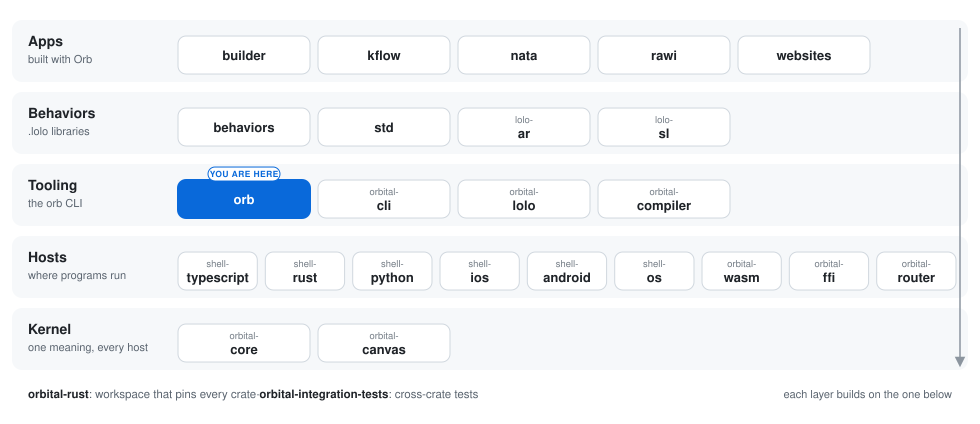

<div align="center">

<picture>
  <source media="(prefers-color-scheme: dark)" srcset="static/img/orb-icon-dark.svg">
  
</picture>

# Orb

### A programming language of composable state machines.

Orb is a programming language in which every program is a composition of finite-state behaviors represented as data.
The compiler checks every path, and one source compiles to five platforms.

[Docs](https://orb.almadar.io/docs) · [Playground](https://orb.almadar.io/playground) · [Standard library](https://orb.almadar.io/stdlib) · [Blog](https://orb.almadar.io/blog)

[](https://www.npmjs.com/package/@almadar/orb)
[](https://github.com/almadar-io/orb/actions/workflows/ci.yml)

</div>

## Getting started

```sh
npx -y @almadar/orb serve checkout.lolo     # run a program; nothing to install
npm install -g @almadar/orb                 # or install orb
curl -fsSL https://orb.almadar.io/install.sh | sh
```

Or hand Orb to an agent. Orb provides a Model Context Protocol (MCP) server; any MCP-capable agent can run it through npx and use its tools to write and check programs:

```text
Build me a chat app in Orb.
Orb runs through npx. Register its MCP server with `npx -y @almadar/orb mcp install --client <your client>`, or start it directly with `npx -y @almadar/orb mcp`.
Then build with its tools: read `reference`, find behaviors with `behaviors` and `describe_behavior`, compose them, run `validate` until it reports 0 errors and 0 warnings, `play` the machine, and run it with `npx -y @almadar/orb serve <file>`.
```

## Programs as state machines

An order that cannot ship before it is paid. Each step is a transition; the data (`entity`), the states, the events that move between them, the guard (`when`) and the screen at each step live in one file.

`checkout.lolo`:

```lisp
app checkout [
  version: "1.0.0",
  description: "An order that cannot ship before it is paid."
]
orbital Orders {
  entity Order [runtime] {
    id : string!
    total : number
  }

  trait Checkout -> Order [client] {
    initial: pending

    state pending {
      INIT -> pending
        (render-ui main { type: button, label: "Pay 40", action: PAY, actionPayload: { amount: 40 } })
      PAY -> paid when (> ?amount 0)
        (set @entity.total ?amount)
        (render-ui main { type: button, label: "Ship", action: SHIP })
    }

    state paid {
      INIT -> pending
        (render-ui main { type: button, label: "Pay 40", action: PAY, actionPayload: { amount: 40 } })
      SHIP -> shipped
        (render-ui main { type: button, label: "New order", action: NEW_ORDER })
    }

    state shipped {
      INIT -> pending
        (render-ui main { type: button, label: "Pay 40", action: PAY, actionPayload: { amount: 40 } })
      NEW_ORDER -> pending
        (render-ui main { type: button, label: "Pay 40", action: PAY, actionPayload: { amount: 40 } })
    }

    emits {
      PAY { amount : number! }
    }
  }

  page "/checkout" -> Checkout
}
```

There is no `SHIP` out of `pending`, so an unpaid order cannot ship. That is not a test you hope someone wrote: it is the shape of the program, and the state diagram is generated from the same source.

## Composition of library behaviors

You rarely write every state machine yourself. Each component on the screen is a library behavior: the application imports it and supplies its data, event names and configuration; the state machine is defined by the library.

```lisp
uses Browse from "std/behaviors/std-browse"
uses Stats from "std/behaviors/std-stats"
uses Graphs from "std/behaviors/std-graphs"

trait DemoStockPageList = Browse.traits.BrowseItemBrowse -> DemoStockItem {
  config {
    browseLook: "dense"
    searchField: "name"
    orderBy: "position"
    displayPageSize: 12
    itemClickEvent: VIEW
  }
}
```

The [standard library](https://orb.almadar.io/stdlib) covers lists, forms, wizards, dashboards, data tables, games and learning instruments, each one a `.lolo` file.

## Agents as behaviors

An assistant composed into an application uses the application's declared inputs as its tools. It acts as the signed-in user, through the same transitions as user interaction.

- Each added module extends the assistant's available actions.
- Guards and access rules apply to the assistant as they apply to a user.
- The state machine, not the prompt, determines the outcome.

## A closed vocabulary

Orb has a fixed set of operators, UI patterns and validation codes, counted from the installed catalog. A model selects from this closed vocabulary rather than inventing an API, and each error is reported with a code, a source location and a suggested fix. Delete the `SHIP` transition and validate again:

```console
$ orb validate checkout.lolo
❌ [ORB_T_STATE_UNREACHABLE] State 'shipped' is unreachable from the initial state 'pending' via any transition path @ 11:3
   💡 Add a transition that reaches this state, or remove the dead state
❌ [ORB_X_RENDER_UI_EVENT_LITERAL_STALE] Prop 'action' on 'button' references event 'SHIP' but the trait's event set has no such key @ 19:10
   💡 Either add 'SHIP' to the trait's emits / listens / transition events, or rewrite the literal to match an existing event key
Error: Schema validation failed with 3 error(s)
```

## Multilingual syntax

A program can be written with English, Arabic or Slovenian keywords; all versions compile to the same code. Further languages can be added by the community as language packs ([lolo-ar](https://github.com/almadar-io/lolo-ar), [lolo-sl](https://github.com/almadar-io/lolo-sl)).

## Compilation targets

The compiler produces each of the following from the same `.lolo` source: **TypeScript + React**, **Python**, **Rust**, **Swift for iOS** and **Kotlin for Android**.

```sh
orb validate checkout.lolo                       # 0 errors and 0 warnings is the bar
orb verify checkout.lolo                         # play every transition and check it does what it declares
orb serve checkout.lolo --open                   # run it in the browser
orb compile checkout.lolo --output ./checkout    # a full application you can deploy
```

## How it fits together

<picture>
  <source media="(prefers-color-scheme: dark)" srcset="static/img/readme/architecture/orb-dark.svg">
  
</picture>

You write `.lolo`. `orb` lowers it to the `.orb` program, validates the whole graph and runs or compiles it on a host; one kernel ([orbital-core](https://github.com/almadar-io/orbital-core)) gives it the same meaning on every host. The [standard library](https://github.com/almadar-io/almadar-std) is itself written in `.lolo`.

## This repository

This repo is how `orb` reaches you, and the source of [orb.almadar.io](https://orb.almadar.io). It holds the installers (`cli/install.sh`, `cli/install.ps1`), the `@almadar/orb` npm launcher and its five platform packages (`@almadar/orb-<platform>`), the published binaries and GitHub releases, and the reusable [`orb-advisory-redeploy`](.github/workflows/orb-advisory-redeploy.yml) workflow that redeploys an app when an urgent release goes out:

```yaml
# .github/workflows/orb-advisory.yml in your app
on:
  repository_dispatch:
    types: [orb-advisory]
jobs:
  redeploy:
    uses: almadar-io/orb/.github/workflows/orb-advisory-redeploy.yml@main
    with:
      programs: "app.lolo"
      deploy-command: "npm run deploy"
    secrets: inherit
```

The compiler and the CLI itself live in [orbital-cli](https://github.com/almadar-io/orbital-cli), [orbital-lolo](https://github.com/almadar-io/orbital-lolo) and [orbital-compiler](https://github.com/almadar-io/orbital-compiler).

## License

Documentation and site content: [CC BY 4.0](./LICENSE). The `orb` CLI and its npm packages: BSL 1.1, converting to Apache 2.0 on 2030-02-01; non-production use is free.
